# Cloud-Connected AQI Network for Pakistan

Low-cost, battery-powered air-quality nodes for Islamabad. Each node measures **PM2.5, PM1, CO and SO₂**, computes a standards-based **time-weighted AQI on the device**, shows it on an OLED, uploads it to the cloud over **MQTT**, and falls back to **hourly SMS alerts** when Wi-Fi is unavailable. About 3.5 months of collected data were used to compare four regression models.

> **Final-year project (BS Electrical Engineering), Institute of Space Technology, Islamabad, July 2024.**
> **Authors:** Amna Ahmad, Zujaja Ibrahim · **Supervisor:** Faraan Mahmood
> Full write-up: [`docs/THESIS_FYP_REPORT[Final].pdf`](docs/THESIS_FYP_REPORT%5BFinal%5D.pdf)

<!-- Add one line on what YOU personally built, e.g. "My part: firmware, AQI algorithm and ML pipeline." Recruiters want to know this for a two-person project. -->

<p align="center">
  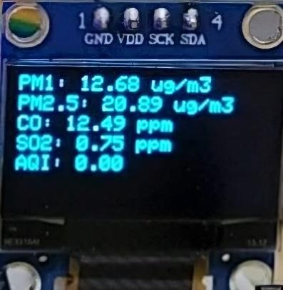
  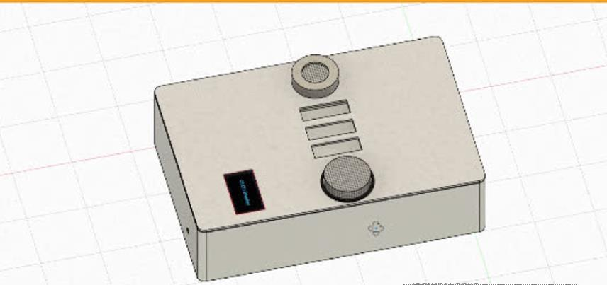
  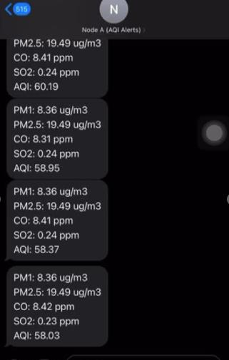
</p>

## At a glance

| | |
|---|---|
| **Problem** | Islamabad lacks affordable real-time AQI monitoring and local data for decisions. |
| **Node** | ESP32 + DSM501A (PM1/PM2.5) + MQ-7 (CO) + MQ-135 (SO₂) + SSD1306 OLED + SIM800L, powered by a 5 V / 2 A power bank |
| **On-device AQI** | EPA breakpoints, exponentially time-weighted over the last 24 hourly readings, combined with per-pollutant weights |
| **Connectivity** | Wi-Fi + MQTT to **AWS IoT Core** (storage) and **Blynk IoT** (dashboards); GSM SMS fallback |
| **Power** | Deep sleep between hourly readings. The thesis estimates **~97.5%** of battery life conserved. |
| **Data** | Hourly readings from **10 March to early July 2024**, **2,718 rows × 7 columns**, no missing values |
| **ML** | Linear Regression, Random Forest, Gradient Boosting and CatBoost on a chronological 80/20 split. **Best: CatBoost, test R² 0.804, RMSE 47.3** (Random Forest is a close, 13× faster second). |
| **Hardware design** | Custom PCB (Proteus), 3D-printed casing (Fusion 360), wiring in Fritzing |

## System architecture

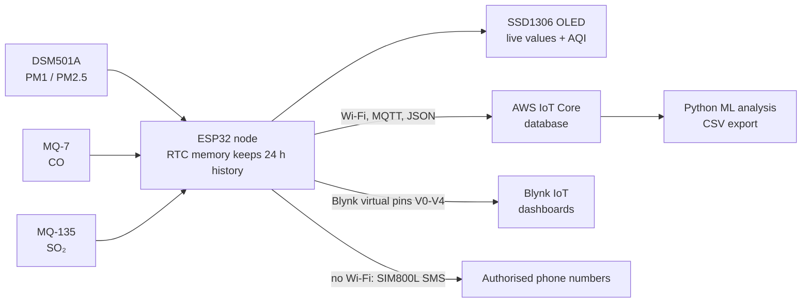

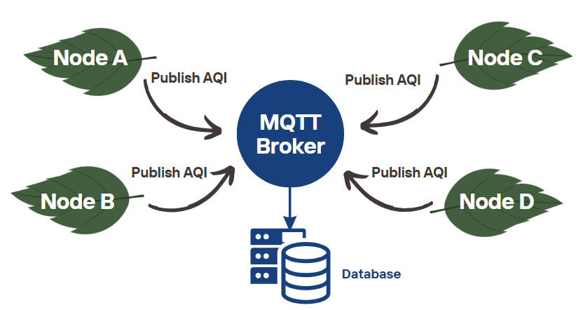

## How a node works

Each cycle repeats once per hour:

1. **Wake** from deep sleep (the ESP32 RTC timer triggers it).
2. **Sample** the sensors: DSM501A low-pulse occupancy over a 30 s window; MQ-7 and MQ-135 analog readings averaged over several samples.
3. **Convert** raw readings to concentrations (see [Sensor calibration](#sensor-calibration)).
4. **Store** each pollutant in a 24-slot circular queue kept in RTC memory, so history survives sleep.
5. **Compute AQI** per pollutant with the EPA linear-interpolation formula, then combine into one time-weighted composite AQI.
6. **Display** values on the OLED, **upload** to the cloud (Blynk virtual pins: V0 PM1, V1 PM2.5, V2 CO, V3 SO₂, V4 AQI), or **send an SMS** if Wi-Fi is down.
7. **Sleep** until the next hour.

### Sensor calibration

- **MQ-7 (CO) and MQ-135 (SO₂):** sensor resistance `Rs = ((Vc − V_RL) / V_RL) · RL`; reference resistance `R0` measured in clean air (for the MQ-7, `Rs/R0 = 20.8` in fresh air); concentration from the datasheet sensitivity curve linearised on a log-log scale, `log(Rs/R0) = m·log(x) + b`.
- **DSM501A (PM1, PM2.5):** low-pulse ratio `= t_low / 30 s × 100%`, mapped to concentration using the datasheet characteristic curve and converted to µg/m³.

### AQI calculation

For each pollutant, `AQI = ((I_H − I_L) / (C_H − C_L)) × (C − C_L) + I_L` using EPA breakpoints. Readings are then weighted so **recent hours count more** (exponential decay, factor 0.5), and the pollutant AQIs are merged with composite weights that reflect health impact. Categories: Good 0–50, Moderate 51–100, Unhealthy for Sensitive Groups 101–150, Unhealthy 151–200, Very Unhealthy 201–300, Hazardous 300+.

## Hardware

| Component | Role |
|---|---|
| ESP32 | Dual-core Wi-Fi MCU: sensing, AQI, cloud upload, deep sleep |
| DSM501A | Particulate matter (PM1, PM2.5) by light scattering |
| MQ-7 | Carbon monoxide |
| MQ-135 | Gas sensor used for SO₂ estimation |
| SSD1306 OLED (128×64, I²C, address 0x3C) | Low-power display used on most nodes. A 1.8″ TFT (160×128) was also built into Node A but draws far more energy. |
| SIM800L | GSM module for hourly SMS to pre-programmed numbers |
| 5 V / 2 A power bank | Portable supply |

### Circuit and PCB design

Two node variants were built. **Node A** uses the 1.8″ TFT display and **Node B** uses the SSD1306 OLED. Each was wired and tested in Fritzing, then turned into a schematic and PCB layout in Proteus.

<p align="center">
  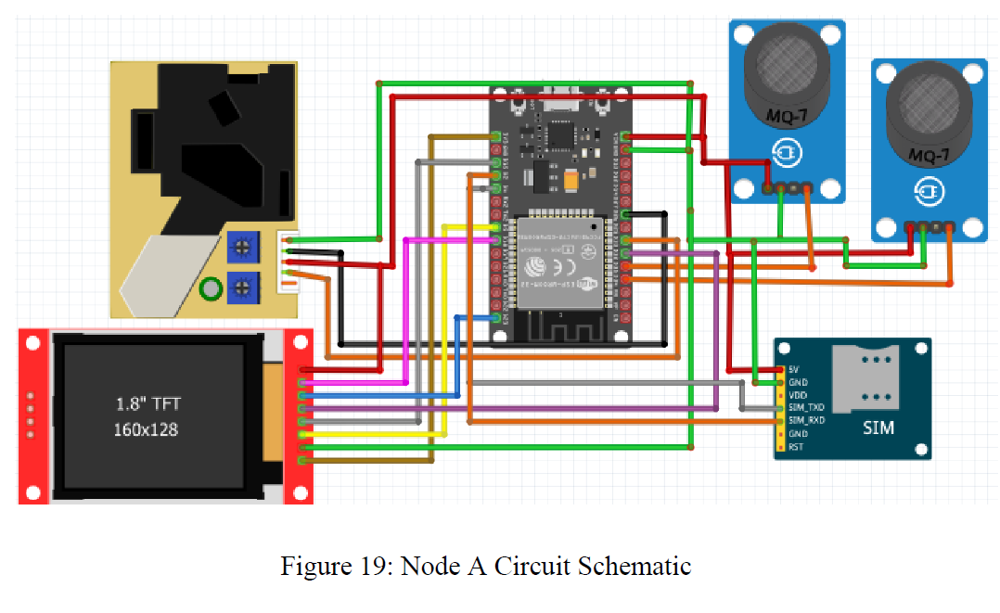
  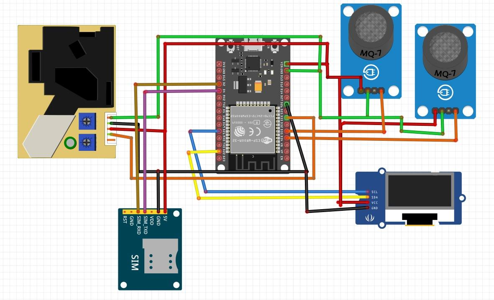
</p>
<p align="center"><sub>Wiring diagrams for Node A (left) and Node B (right). Fritzing has no MQ-135 part, so the second gas module is drawn with the MQ-7 symbol.</sub></p>

<p align="center">
  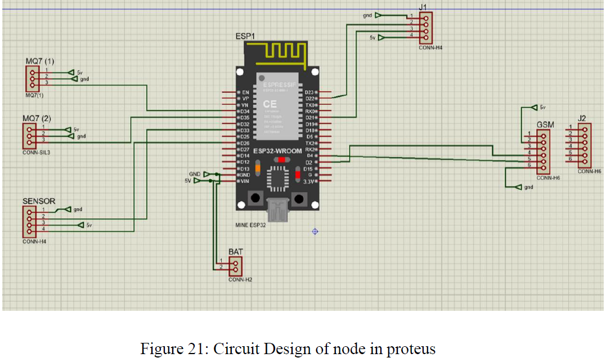
  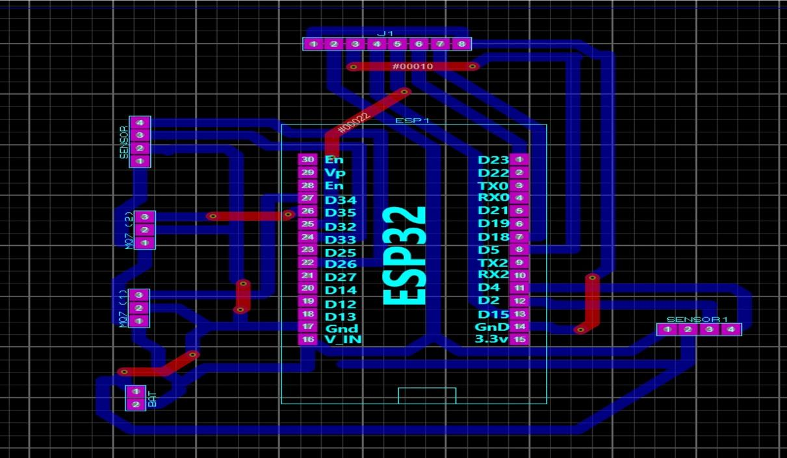
  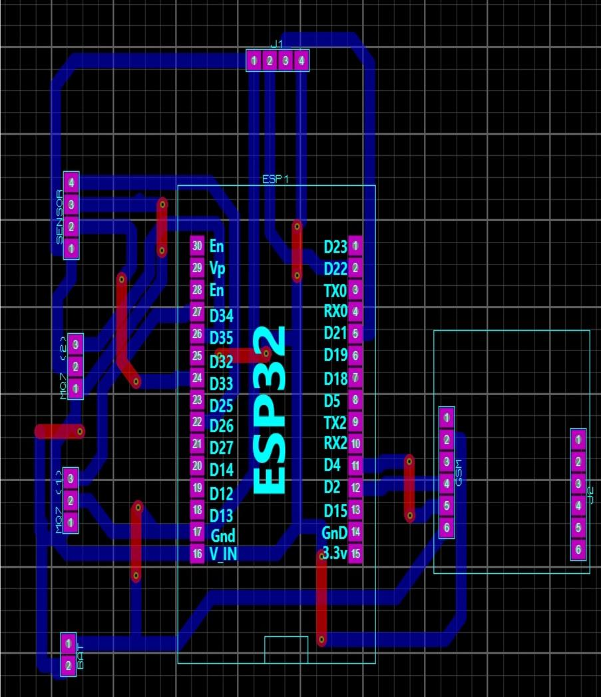
</p>
<p align="center"><sub>Proteus schematic and the two PCB layouts. Female headers carry the sensors, display and SIM module so they plug straight into the ESP32 board.</sub></p>

## Cloud and dashboards

Nodes publish JSON over MQTT using certificate- and token-based authentication. AWS IoT Core stores the data (exported as CSV for analysis), and each node has its own Blynk template for live per-node pollutant values and AQI.

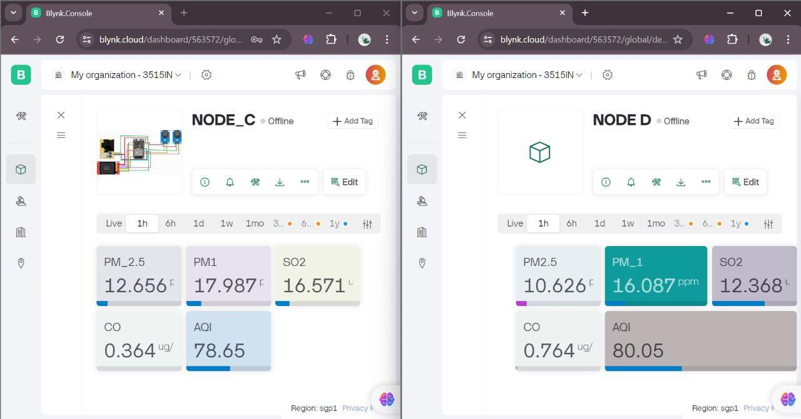

## Dataset

| | |
|---|---|
| File | [`data/Node1.csv`](data/Node1.csv) |
| Period | 10 March to early July 2024, hourly |
| Size | 2,718 rows × 7 columns (`Datetime`, `PM_2.5`, `PM_1`, `SO2`, `CO`, `Total_AQI`, `Category`) |
| Quality | No missing values |
| Trend | AQI declines from March towards the summer months, consistent with seasonal patterns in Pakistan |

## Machine learning

**Task:** regress `Total_AQI` from the four pollutant readings (`PM_2.5`, `PM_1`, `SO2`, `CO`).
**Split:** chronological, with the first 80% of rows for training and the last 20% for testing (`train_index = int(0.8 * len(X))`), so no future data leaks into training.
**Metrics:** training time, train/test R², RMSE.

**Correlations (Kendall):** PM2.5–PM1 0.82; AQI–PM1 0.77; AQI–PM2.5 0.76; AQI–SO₂ 0.51; AQI–CO 0.046 (weak).

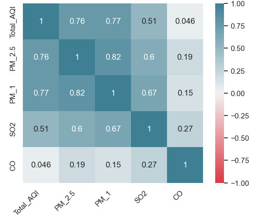

**Results on the held-out 20%** (test target has a standard deviation of roughly 107 AQI points):

| Model | Setup | Train time | Train R² | **Test R²** | **RMSE** |
|---|---|---|---|---|---|
| Linear Regression | `StandardScaler` + `LinearRegression` | ~0 s | 0.654 | 0.669 | 62.58 |
| Random Forest | 100 trees, `max_depth=100`, `min_samples_split=6`, `max_features='log2'` | 0.27 s | 0.941 | 0.801 | 47.70 |
| Gradient Boosting | 50 trees, `max_depth=10`, `learning_rate=0.1`, `max_features='sqrt'` | 0.61 s | 0.981 | 0.798 | 48.95 |
| **CatBoost** | `RandomizedSearchCV`, 100 candidates × 5-fold CV | 3.48 s | 0.960 | **0.804** | **47.32** |

**Takeaways**
- **CatBoost scored best** (R² 0.804, RMSE 47.3), but **Random Forest is nearly identical (R² 0.801) and about 13× faster to train**, so it is the practical choice for a model that may run on small hardware.
- **All three tree-based models clearly beat linear regression** (R² ≈ 0.80 vs 0.67, RMSE ≈ 47–49 vs 62.6), so the pollutant-to-AQI relationship is non-linear.
- **The tree models overfit somewhat**: train R² of 0.94–0.98 against test R² of about 0.80. Linear regression underfits instead (0.65 train, 0.67 test).

<!-- The thesis table also lists a MAPE row (2.05 to 2.81). Those values do not fit the RMSE: with a target std of ~107 and RMSE ~47, a MAPE of 2% is not possible, and as a fraction 2.05 would mean a 205% error. Recompute MAPE in the notebook before quoting it anywhere. -->

<sub>Source: model comparison table in Chapter 5 of the thesis. See also [`docs/images/model_comparison_table.png`](docs/images/model_comparison_table.png).</sub>

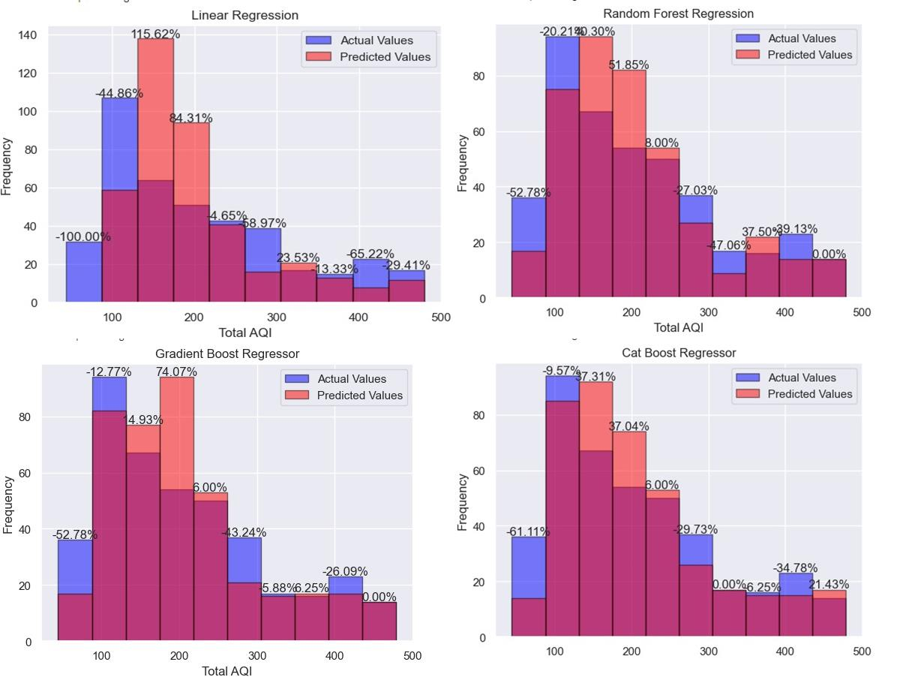

*Actual (blue) vs predicted (red) AQI distributions on the held-out 20%. All four models under-predict the lowest-AQI bin, and the tree-based models track the overall distribution more closely than linear regression.*

## Repository structure

```
├── esp32_node/src/node_aqi_code_esp32.ino        # Firmware: sensing, AQI, cloud, sleep, SMS
├── analytics/src/AQI_Predictive_Analysis.ipynb   # EDA, correlation, model training and evaluation
├── data/Node1.csv                                # Hourly dataset from Node 1
├── docs/
│   ├── THESIS_FYP_REPORT[Final].pdf              # Full thesis
│   └── images/                                   # Figures used in this README
└── README.md
```

## Getting started

**Firmware**
1. Install the Arduino IDE with ESP32 board support.
2. Install the libraries the sketch includes: `WiFi`, `BlynkSimpleEsp32`, `Adafruit_SSD1306` / `Adafruit_GFX`, and `[your SIM800L / SMS library]`.
3. In `node_aqi_code_esp32.ino`, set Wi-Fi SSID/password, Blynk template ID / device name / auth token, and the authorised phone numbers. **Keep real credentials out of Git** (use placeholders in the committed file).
4. Check `TIME_TO_SLEEP`: the thesis's code excerpt shows 3 s, which is a test value. Use 3600 s for hourly readings.
5. Flash the board and open the Serial Monitor at **115200 baud**. You should see the queued readings, per-pollutant AQIs, the final AQI, the Wi-Fi IP, "Sending data to Blynk Cloud", then deep sleep.

**Analysis**
```bash
git clone https://github.com/amnaahmad43200/cloud-connected-aqi-network.git
cd cloud-connected-aqi-network
pip install pandas numpy scikit-learn catboost matplotlib seaborn jupyter openpyxl
jupyter notebook analytics/src/AQI_Predictive_Analysis.ipynb
```

## Limitations

- **This is AQI regression, not future forecasting.** The models predict `Total_AQI` from the pollutant readings of the same hour, while the AQI itself is a time-weighted blend of the last 24 hours of those pollutants. That is why a single hour's readings explain only about 80% of the variance (R² ≈ 0.80) and not close to 100%. Adding lagged features, or using a time-series model, would both improve the fit and allow real forecasting of future AQI.
- **Tree models overfit moderately** (train R² 0.94–0.98 vs test 0.80), and there is a single chronological hold-out, so the scores are indicative rather than final.
- **One node, one location, one season** (spring into early summer), so results may not transfer elsewhere.
- **Low-cost sensors** drift and respond to temperature and humidity.
- **MQ-135 is a broad-spectrum gas sensor** that responds to several gases, so its SO₂ values should be treated as estimates.
- The ~97.5% battery saving is an theoretical estimate, not a measured runtime.

## Future work

- Deploy more nodes across Islamabad and compare locations and seasons.
- Scale the cloud pipeline for many nodes and larger datasets.
- Add true time-ahead forecasting (lag features, LSTM or other time-series models).
- Validate and re-calibrate against a reference monitor; measure real battery runtime.

## UN Sustainable Development Goals

**SDG 3** Good Health and Well-being · **SDG 11** Sustainable Cities and Communities · **SDG 13** Climate Action · **SDG 17** Partnerships for the Goals

## Contact

Amna Ahmad · `[email]` · `[LinkedIn]`
